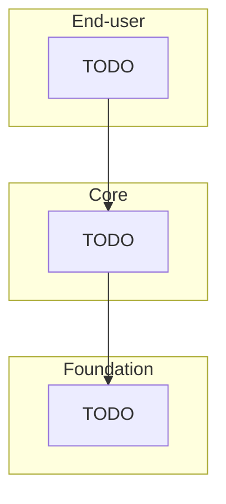

# Architecture

Last reviewed: {{DATE}}

## Modules

{{MODULES_TABLE}}

## Layers

This project follows the OutSystems Architecture Canvas. References only go **down** or **sideways within Foundation**. End-user modules never reference each other, and Core never references End-user.

| Layer | Holds | Typical suffixes |
|---|---|---|
| End-user | Screens and UI flows for one user group | (none), `_UI`, `_Portal` |
| Core | Entities, business rules and services shared across apps | `_CS`, `_BL` |
| Foundation | Reusable non-business pieces: integrations, themes, patterns | `_IS`, `_Th`, `_Pat`, `_Lib` |

## External references

{{REFERENCES_LIST}}

## Integrations

TODO: external systems (REST, SOAP, SAP, databases), the module that owns each one, and where its credentials are configured. Never put the credentials here.

## Open questions

- TODO
